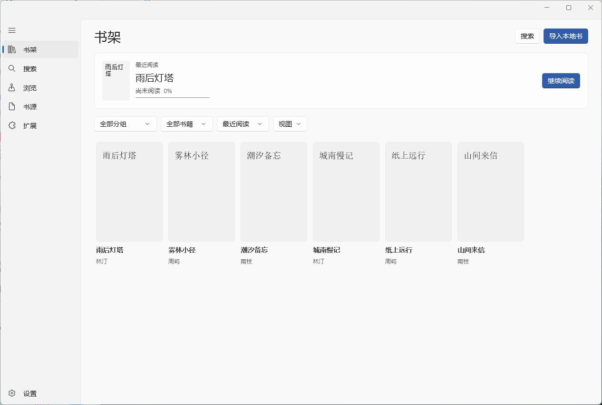
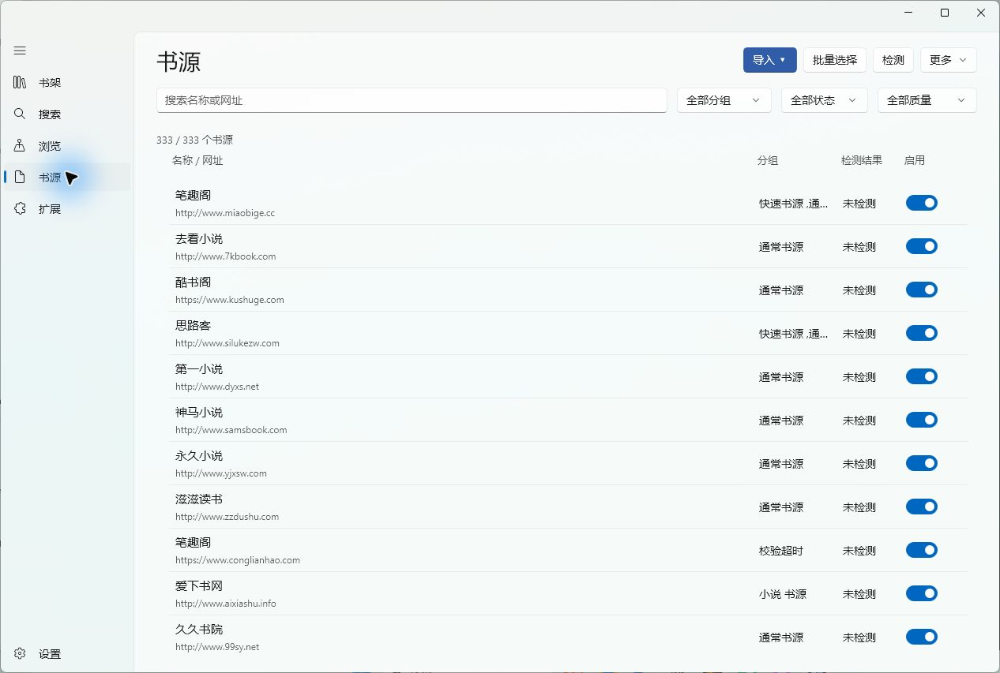

<p align="center">
  
</p>

<h1 align="center">Legado·UI3</h1>

<p align="center">面向 Windows x64 的 Legado 桌面改版 · 使用 WinUI 3 构建</p>

<p align="center"><a href="https://github.com/ShenShenSshen/Legado.UI3/releases/latest">下载 Windows x64 安装版或便携版</a></p>

## 项目介绍

Legado·UI3 以 [Legado 手机端（阅读 3.0）](https://github.com/gedoor/legado) 的书源生态和阅读流程为基础，面向 Windows 重新设计了书架、搜索、书源管理和阅读器。已有 Legado 书源可通过 JSON 文件或网络链接导入，网络朗读也支持常用的 Legado TTS 配置。

桌面版使用 C# 和 WinUI 3 重新实现，支持大屏排版、键盘操作、本地书文件拖放和 Windows 系统朗读。Legado·UI3 由本仓库独立维护。

## 功能

- **书架与阅读** — 导入或拖放 TXT、EPUB，按分组管理书籍。支持翻页、连续滚动、目录、书签和进度恢复，可调节字体、行距、正文宽度和夜间底色。
- **搜索与发现** — 按书名或作者检索启用的书源，可同时搜索全部书源。切换书源浏览分类、榜单和书单，预览目录或试读后加入书架。
- **书源管理** — 导入 Legado 书源 JSON、本地文件或 GitHub 网络链接。支持分组、启停、检测、批量选择和删除。
- **朗读** — 选择 Windows 系统音色，或导入 Legado TTS 配置和网络接口。支持试听、调节语速、读完续章和批量删除网络音色。
- **备份与更新** — 支持本地备份恢复及 WebDAV 同步。启动时检查正式版，有新版才提示。确认后通过国内加速线路或 GitHub 下载，校验后保存进度并重启。

## 界面截图

书架和阅读器截图使用演示数据，书源管理截图展示实际导入的 333 条书源，网址仅显示站点域名。

### 书架



### 阅读器


### 书源管理



## 技术栈

| 技术 | 在项目中的用途 |
| --- | --- |
| **C#、.NET 10、WinUI 3、Windows App SDK** | 构建 Windows 原生窗口、导航、书架、书源管理和设置页面。 |
| **Microsoft Edge WebView2、HTML、CSS、JavaScript** | 渲染阅读器正文和分页，运行书源规则适配逻辑，处理需要网页渲染的章节。 |
| **Windows Speech Synthesis 与 HTTP TTS** | 播放系统朗读音色，或连接支持的网络语音服务。 |
| **JSON、ZIP 与 WebDAV** | 保存本机书架、书源和进度，提供备份导出、恢复及云端同步。 |
| **GitHub Releases、SHA-256 与 Inno Setup** | 分发并校验更新包，构建 Windows x64 EXE 安装版。 |

## 下载与运行

从 [GitHub Releases](https://github.com/ShenShenSshen/Legado.UI3/releases/latest) 选择 Windows x64 版本：

- **安装版** `*-win-x64-Setup.exe`。运行安装程序，完成后从开始菜单打开 Legado.UI3。可以选择创建桌面快捷方式。
- **便携版** `*-win-x64.zip`。完整解压到一个文件夹，运行 `Legado.UI3.exe`。

应用使用系统的 Microsoft Edge WebView2 Runtime。卸载安装版时会保留本机的书架、书源、阅读进度和音色。

「设置 → 关于」可以手动检查更新。自动更新从 v1.0.1 起可用，安装版和便携版均支持。书架、书源、进度和音色保存在本机数据目录。

## 构建与测试

在 Windows x64 上使用 .NET 10 SDK：

```powershell
dotnet publish .\Legado.UI3.csproj -c Release -p:Platform=x64 -o .\publish\win-x64
.\Tests\Run-Smoke.ps1
```

测试使用独立的临时数据目录。第三方资源许可随资源一并提供，见 [Assets](Assets/)。

生成安装版时，先执行上面的发布命令，再使用 Inno Setup 的 `ISCC.exe /DAppVersion=1.0.1 .\tools\Installer.iss` 编译安装器。
