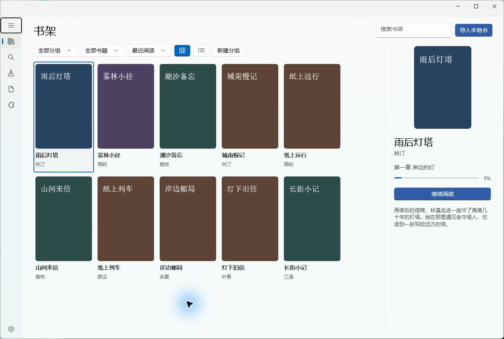
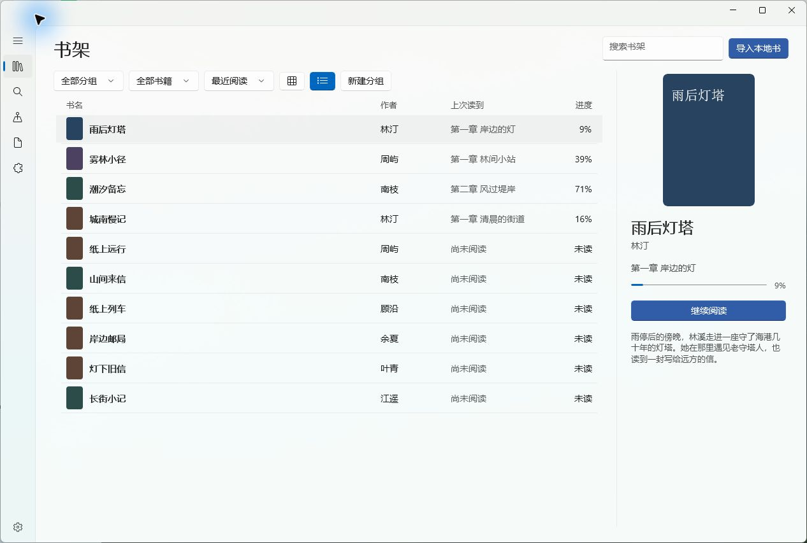
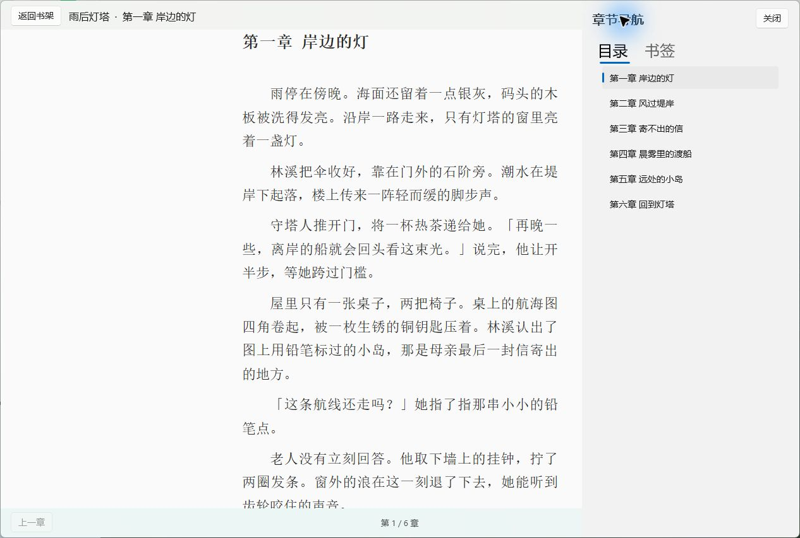
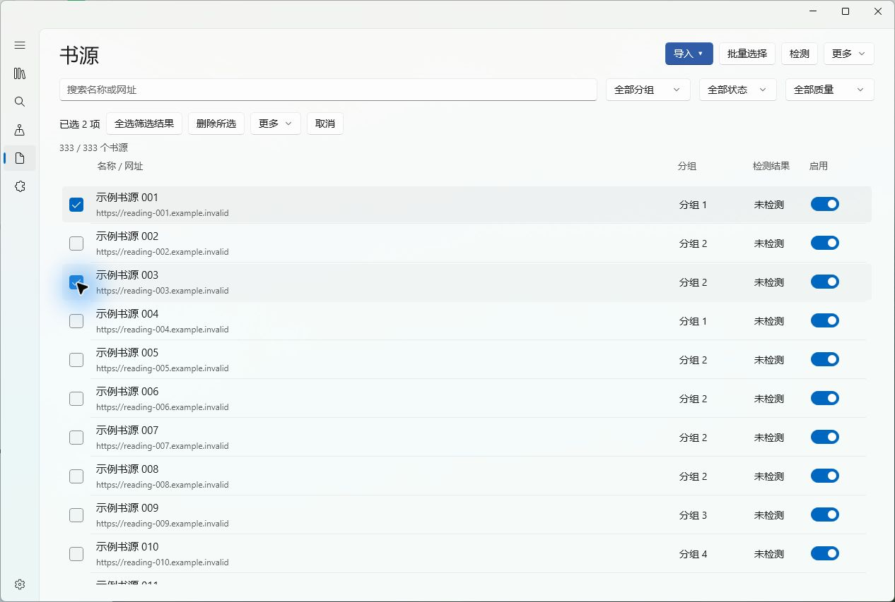

<p align="center">
  
</p>

<h1 align="center">Legado·UI3</h1>

<p align="center">兼容 Legado 书源的 Windows 桌面阅读器，使用 WinUI 3 构建。</p>

<p align="center">
  <a href="https://github.com/ShenShenSshen/Legado.UI3/releases/latest">下载 Windows x64</a> ·
  <a href="#快速上手">快速上手</a> ·
  <a href="#界面截图">界面截图</a> ·
  <a href="#构建与测试">构建与测试</a>
</p>

## 项目介绍

Legado·UI3 把 Legado 手机端的书源规则和阅读流程带到 Windows。你可以沿用已有书源，在电脑上搜索、浏览榜单和阅读网络书籍，也可以直接拖入 TXT 或 EPUB 管理本地图书。桌面版独立维护，书架、阅读器、设置与键盘操作都按 Windows 使用场景重新设计。[Legado 手机端（阅读 3.0）](https://github.com/gedoor/legado)

| 场景 | 可以做什么 |
| --- | --- |
| **管理书架** | 用封面网格浏览，或切到紧凑列表查看书名、作者、章节和进度。支持筛选、排序和分组，读完返回时回到离开前的书架位置。 |
| **阅读与续读** | 在连续滚动和分页间切换。调整字号、行距、段距、正文宽度和背景色后，续读仍可定位到段落内。目录、书签与阅读设置从侧边浮出。 |
| **找书与换源** | 按书名或作者检索启用的书源，也可在「浏览」按来源查看分类和榜单。遇到章节缺失时可为书架里的书切换来源。 |
| **管理书源** | 从本地 JSON、粘贴内容或 GitHub 网络链接导入规则。按分组、启用状态和检测结果筛选，批量启停或删除。 |
| **听书** | 使用 Windows 系统音色，或导入 Legado TTS 配置和 HTTP 朗读接口。可试听、调语速和音调，读完本章后自动续读。 |

## 界面截图

### 书架

选中封面可在右侧查看详情和进度。双击封面进入阅读。



### 紧凑列表

同一个书架可以切换为列表，一次查看更多书名和阅读进度。



### 阅读器

展开目录时，正文保持原来的宽度和滚动位置。网页章节支持在接近章末时提前加载下一章。



### 书源管理

截图按本机 333 条已导入书源制作。名称、网址和分组使用脱敏示例。



## 快速上手

| 下载包 | 运行方式 |
| --- | --- |
| **EXE 安装版** | 运行 `*-win-x64-Setup.exe`，安装后从开始菜单打开，可选建桌面快捷方式。 |
| **ZIP 便携版** | 完整解压 `*-win-x64.zip`，运行目录里的 `Legado.UI3.exe`。 |

应用适用于 Windows 10 2004 及更新版本的 x64 系统，阅读界面使用 Microsoft Edge WebView2 Runtime。下载页同时提供 `SHA256SUMS.txt`。[获取最新正式版](https://github.com/ShenShenSshen/Legado.UI3/releases/latest)

1. **读本地书**。进入「书架」，拖入 TXT 或 EPUB，也可按 `Ctrl+O` 选择文件。阅读器内按 `F11` 切换全屏。
2. **读网络书**。在「书源 → 导入」选择网络链接、本地文件或粘贴 JSON。启用书源后去「搜索」找书，或用「浏览」看分类和榜单。可用内容由站点和导入的规则决定。
3. **从网页开始阅读**。在「搜索」切到「网页」，打开地址后选择「识别书籍」。支持识别的页面可以加入书架，在阅读器内续读。站点的登录和订阅要求仍适用。
4. **设置朗读音色**。在「设置 → 朗读」选择系统音色，或通过「导入网络语音」添加配置。已有运行中的 `legado-edge-tts` 服务时，可填写服务地址添加云希和晓晓。

### 备份与自动更新

- **本地备份**在「设置 → 数据与备份」。可以导出 ZIP 并在另一台电脑恢复。备份包含网络音色、当前选择和接口凭据，可选择是否含本地书原文件。
- **WebDAV** 支持手动或定时备份。默认排除网络音色和当前音色选择，可在「设置 → 云端同步」开启「云备份包含网络音色」。
- **更新**支持启动时检查，也可到「设置 → 关于」手动检查。确认后优先尝试国内下载线路，校验成功后应用更新并重启。安装版与便携版共用本机数据，默认目录为 `%LOCALAPPDATA%\Legado.UI3`。

## 技术栈

| 技术 | 在项目中的用途 |
| --- | --- |
| **C#、.NET 10、WinUI 3、Windows App SDK** | 原生 Windows 窗口、导航、虚拟化书架和书源列表。 |
| **WebView2、HTML、CSS、JavaScript** | 渲染连续滚动和分页正文，记录阅读位置，适配书源规则并读取动态网页章节。 |
| **Windows Speech Synthesis、HTTP TTS** | 调用系统朗读和网络音色服务。 |
| **JSON、ZIP、WebDAV** | 本地读写、备份恢复和云端同步。 |
| **GitHub Releases、SHA-256、Inno Setup** | 发布构建产物、校验自动更新包和生成 EXE 安装器。 |

## 构建与测试

在 Windows x64 上使用 .NET 10 SDK：

```powershell
dotnet publish .\Legado.UI3.csproj -c Release -p:Platform=x64 -o .\publish\win-x64
.\Tests\Run-Smoke.ps1 -GitHub -WebDav
```

测试使用独立数据目录，覆盖书架返回定位、阅读重排、网页续章、书源导入、朗读、备份和更新。构建 EXE 安装器时，先完成上述发布，再运行 `ISCC.exe /DAppVersion=1.0.4 .\tools\Installer.iss`。

反馈问题时请附上版本、复现步骤，以及已脱敏的报错或截图。[GitHub Issues](https://github.com/ShenShenSshen/Legado.UI3/issues)

## 致谢

书源和阅读工作流参考 Legado 手机端。第三方资源许可随资源提供。[Legado 上游](https://github.com/gedoor/legado) · [Assets](Assets/)
